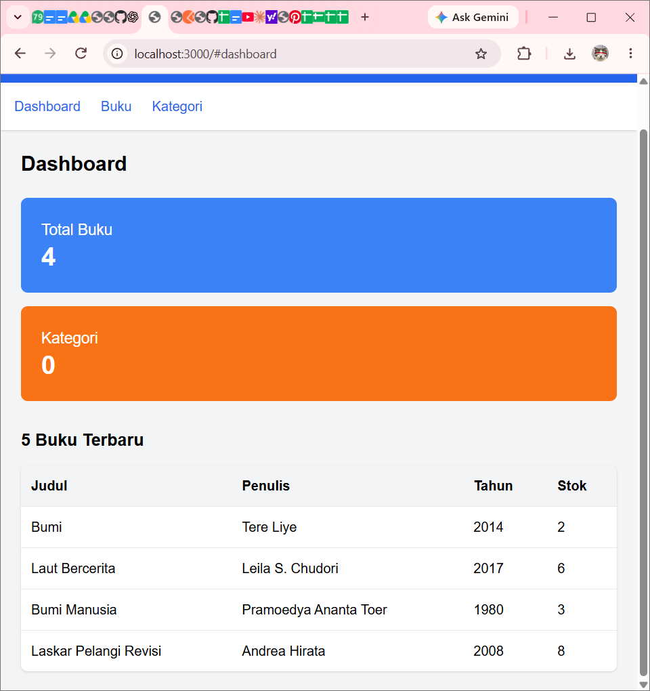
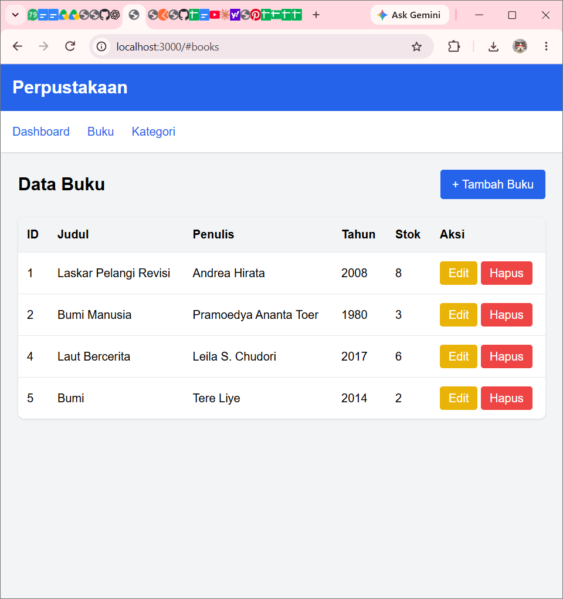
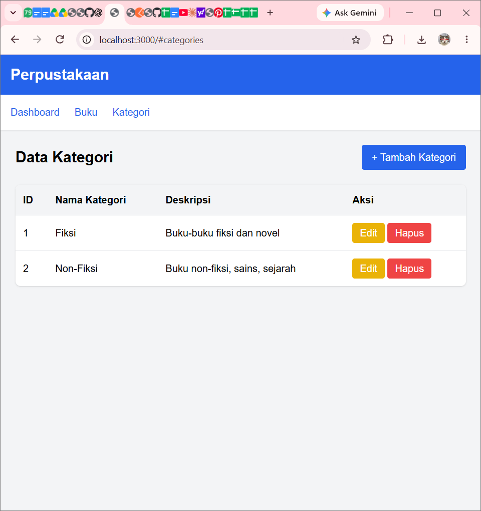

# LKS Pemrograman Berorientasi Objek (PBO)
## REST API Perpustakaan

### Identitas Mahasiswa
- **Nama:** Sri Wahyuni
- **NIM:** H1101251006
- **Kelas:** A

### Deskripsi Proyek
Proyek ini merupakan aplikasi manajemen perpustakaan berbasis web yang menggunakan REST API sebagai penghubung antara backend dan frontend. Aplikasi ini dibuat untuk mengelola data buku dan kategori buku.

### Fitur Aplikasi
1. Dashboard untuk melihat ringkasan data perpustakaan.
2. Menampilkan daftar buku.
3. Menambahkan data buku.
4. Mengedit data buku.
5. Menghapus data buku.
6. Menampilkan daftar kategori.
7. Menambahkan kategori.
8. Mengedit kategori.
9. Menghapus kategori.
10. Integrasi frontend dengan backend melalui REST API.

### Teknologi yang Digunakan
- PHP
- MySQL
- Composer
- HTML
- CSS
- JavaScript
- Git dan GitHub

### Cara Menjalankan Proyek

**1. Menjalankan Backend**

Buka terminal dan masuk ke folder backend:

```bash
cd rest-api-perpustakaan
```

Jalankan server PHP:

```bash
php -S localhost:8000 -t public
```

**2. Menjalankan Frontend**

Buka terminal baru dan masuk ke folder frontend:

```bash
cd frontend-perpustakaan
```

Jalankan server PHP:

```bash
php -S localhost:3000
```

**3. Membuka Aplikasi**

Buka browser dan akses:

`http://localhost:3000`

Pastikan MySQL di Laragon aktif dan konfigurasi database pada file `.env` sudah sesuai.

### Screenshot Akhir Aplikasi

**1. Dashboard**



**2. Halaman Buku**



**3. Halaman Kategori**



### Dokumentasi Setiap Pertemuan
- [Pertemuan 01](pertemuan-01/)
- [Pertemuan 02](pertemuan-02/)
- [Pertemuan 03](pertemuan-03/)
- [Pertemuan 04](pertemuan-04/)
- [Pertemuan 05](pertemuan-05/)
- [Pertemuan 06](pertemuan-06/)
- [Pertemuan 07](pertemuan-07/)

### Repository
Source code dan dokumentasi proyek dapat dilihat melalui repository GitHub ini.

**LKS PBO - REST API Perpustakaan**
